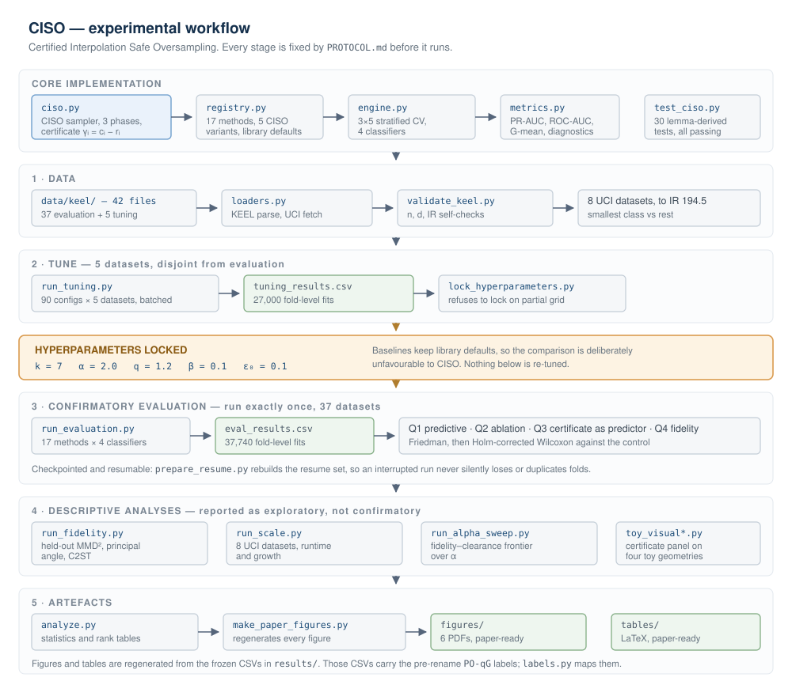
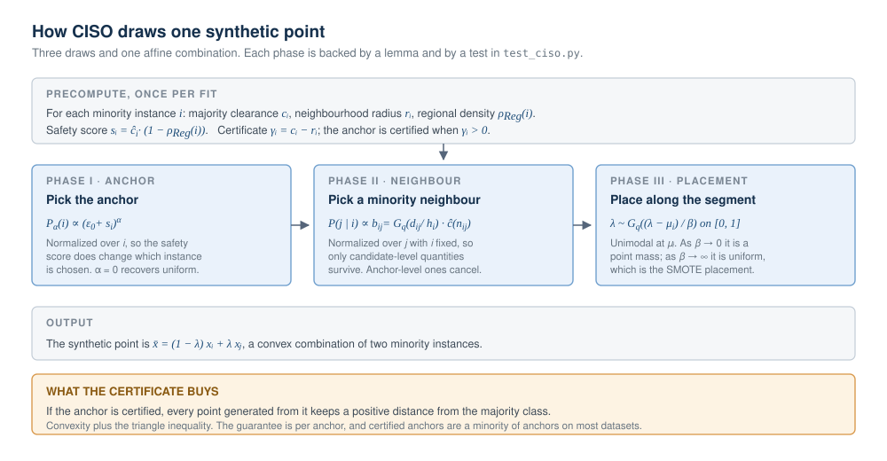

# CISO

**Certified Interpolation Safe Oversampling.** An oversampling method for imbalanced
classification that attaches a per-anchor geometric certificate to the points it generates.

This repository holds the implementation, the preregistered protocol, the frozen run
artefacts, and the scripts that regenerate every figure and table in the paper.



## What the method does

CISO draws a synthetic minority point in three phases. It selects an anchor from a
safety-tilted distribution, selects a neighbour weighted by that candidate's own clearance,
and places the point along the segment with a q-Gaussian kernel.



The certificate is $\gamma_i = c_i - r_i$, the majority clearance of anchor $i$ minus its
neighbourhood radius. An anchor is certified when $\gamma_i > 0$. Every point generated
from a certified anchor keeps a positive distance from the majority class. The proof is
convexity plus the triangle inequality.

The guarantee is per anchor, not per dataset. Certified anchors are sparse in practice.
The median certified fraction is 0.042 across the 37 evaluation datasets, and it is zero on
13 of them. Coverage is high only where the classes are already well separated. This is
reported in the paper, and it is the main limitation of the method.

## Install

```bash
python -m venv .venv && source .venv/bin/activate
pip install -r requirements.txt
```

Python 3.10 or newer. `numpy`, `pandas`, `scikit-learn`, `scipy` and `matplotlib` are enough
to run CISO itself and to regenerate the figures. `imbalanced-learn`, `smote-variants` and
`ucimlrepo` are needed only to re-run the benchmark against the baselines.

## Quick start

CISO follows the `fit_resample` interface, so it drops into an existing pipeline.
Standardize the features first, because `fit_resample` does not scale them.

```python
import numpy as np
from sklearn.preprocessing import StandardScaler
from ciso import CISO

X = StandardScaler().fit_transform(X_raw)        # y must be 0 (majority) and 1 (minority)

sampler = CISO(k=7, alpha=2.0, q=1.2, beta=0.1, eps0=0.1, random_state=0)
X_res, y_res = sampler.fit_resample(X, y)

print("certified anchors: %.1f%%" % (100 * np.mean(sampler.gamma_ > 0)))
```

Those are the locked hyperparameters from the paper. They were selected on a tuning suite
that is disjoint from the evaluation suite, and they were not changed afterwards.

| Parameter | Value | Role |
|---|---|---|
| `k` | 7 | neighbourhood size, both classes |
| `alpha` | 2.0 | anchor tilt; 0 is uniform, negative seeks the boundary |
| `q` | 1.2 | tail index of the q-Gaussian, shared by Phase II and Phase III |
| `beta` | 0.1 | placement scale, as a fraction of the segment |
| `eps0` | 0.1 | positive floor in the anchor distribution |

## Reproducing the paper

The protocol in [`PROTOCOL.md`](PROTOCOL.md) was frozen before the benchmark ran. It fixes
the research questions, the decision rules, the datasets, the metrics and the statistics.
Run the stages in order.

```bash
python validate_keel.py                 # dataset self-checks: n, d, imbalance ratio
python run_tuning.py                    # 90 configs on 5 tuning datasets
python lock_hyperparameters.py          # refuses to lock on a partial grid
python run_evaluation.py                # confirmatory run, 37 datasets, run once
python run_fidelity.py                  # Q4, held-out MMD-squared, principal angle, C2ST
python run_scale.py                     # 8 UCI datasets, up to imbalance ratio 194.5
python run_alpha_sweep.py               # fidelity and clearance frontier over alpha
python analyze.py                       # statistics and rank tables
python make_paper_figures.py            # rank, sensitivity, fidelity, frontier
python make_runtime_figure.py           # runtime
```

Every run script checkpoints and resumes. An interrupted run neither loses folds nor
duplicates them. The long runs append to their CSV after each batch, so you can stop and
restart them.

The CSVs in `results/` are the frozen artefacts of the runs reported in the paper. The
figure and table scripts read those by default, so you can regenerate the figures without
re-running the benchmark:

```bash
python make_paper_figures.py            # reads results/, writes figures/
python make_runtime_figure.py
```

Override the input and data locations with `CISO_RESULTS` and `CISO_KEEL` if you want to
keep a fresh run separate from the frozen one.

Five of the six figures regenerate from the frozen CSVs. The sixth,
`fig_certificate_panel.pdf`, is a panel over four controlled toy geometries rather than a
plot of the run artefacts, so it is shipped as a file and is not rebuilt by these scripts.
`make_paper_figures.py` also emits `fig_reliability.pdf`, which the paper does not use.

### Scale of the runs

| Suite | Datasets | Methods | Classifiers | Model fits | Resamplings |
|---|---|---|---|---|---|
| Tuning | 5 | 90 configs | 4 | 27,000 | 6,750 |
| Evaluation | 37 | 17 | 4 | 37,740 | 9,435 |
| Scale | 8 | 17 | 3 | 6,120 | 2,040 |
| **Total** | | | | **70,860** | **18,225** |

All suites use 3 repeats of 5-fold stratified cross-validation.

## Tests

```bash
python test_ciso.py
```

Thirty tests, each derived from a lemma in the paper. They check the certificate directly,
the convexity bound, the uniform limit at $\alpha = 0$, the likelihood-ratio ordering, the
two limiting regimes of the placement kernel, and the parser against the real KEEL files.
All thirty pass.

## What the results show

The paper is a negative result, reported as one. Four hypotheses were preregistered, and
none of them held.

- CISO does not beat the baselines on predictive performance. Its best standing is second of
  eleven methods on PR-AUC under gradient boosting, behind random oversampling.
- The ablations do not separate. No single component carries the method.
- The certificate does not predict where CISO helps. The correlation is 0.000.
- Fidelity does not improve over the interpolation baselines at the locked setting.

What survives is geometric. The $\alpha$ sweep traces a continuous frontier between
distributional fidelity and majority clearance, and CISO moves along it under a single
parameter. That is the contribution the paper defends.

CISO is also slow. It is roughly 48 times SMOTE's median resampling time on the evaluation
suite, and 104 times on the larger scale suite. Resampling cost is small next to the cost of
fitting a boosted tree, so the practical penalty depends on the classifier.

## Repository layout

```
ciso.py                   the sampler, with the certificate
labels.py                 canonical method labels and the legacy map
loaders.py                KEEL parser and UCI fetch, with self-checks
registry.py               the 17 methods under comparison
engine.py                 cross-validation harness
metrics.py                PR-AUC, ROC-AUC, G-mean, synthesis diagnostics
fidelity.py               unbiased MMD-squared, principal angle, C2ST
test_ciso.py              30 lemma-derived tests

run_tuning.py             stage 2, hyperparameter grid
lock_hyperparameters.py   stage 2, applies the preregistered lock criterion
prepare_resume.py         rebuilds the resume set for an interrupted run
run_evaluation.py         stage 3, the confirmatory run
run_fidelity.py           stage 4, Q4
run_scale.py              stage 4, larger datasets
run_alpha_sweep.py        stage 4, the frontier
analyze.py                statistics and rank tables
make_paper_figures.py     rank, sensitivity, fidelity and frontier figures
make_runtime_figure.py    runtime figure
toy_visual.py             certificate panel on toy geometries
toy_visual_overlap.py     certificate panel under class overlap

PROTOCOL.md               the preregistration, frozen before the benchmark
data/keel/                42 KEEL files, 37 evaluation and 5 tuning
results/                  frozen run artefacts
figures/                  paper figures, PDF
tables/                   paper tables, LaTeX
docs/                     workflow and method diagrams
```

## Data

The 42 KEEL files are included under `data/keel/`. They come from the
[KEEL imbalanced data repository](https://sci2s.ugr.es/keel/imbalanced.php).

The 8 scale datasets are fetched from the UCI repository at run time through `ucimlrepo`, so
`run_scale.py` needs network access. The positive class is the smallest class against the
rest, applied uniformly, with no per-dataset exceptions.

## A note on naming

The method was called **PO-qG** while the experiments ran. It was renamed **CISO** before
submission. The two names refer to the same method and the same code.

The CSVs in `results/` are the frozen run artefacts, and they still carry the old labels.
They are shipped unmodified, because rewriting a frozen record is worse than carrying a map.
`labels.py` holds that map, and the analysis scripts apply it on load. `poqg.py` remains as a
deprecated import alias so that archived scripts keep working.

## Citation

See [`CITATION.cff`](CITATION.cff). Please cite the paper rather than this repository alone.

## License

MIT, see [`LICENSE`](LICENSE). The KEEL files under `data/keel/` are redistributed under the
terms of their original repository and are not covered by this license.
